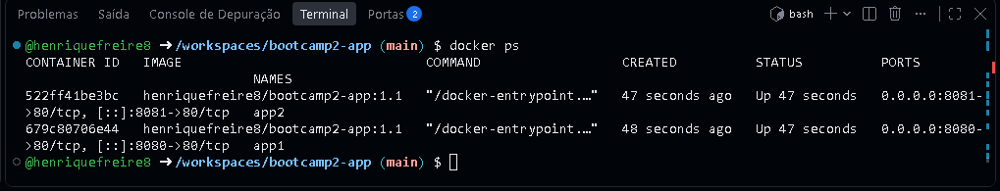

# Pokédex Simples

## Autor
Henrique Cysne Furquim Freire — Matrícula 22605332

## Descrição
Aplicação web simples que permite buscar um Pokémon pelo nome, ver sua imagem, altura e peso e montar um time de até 6 Pokémon, salvo em um banco de dados.

## API utilizada
- PokeAPI — https://pokeapi.co/
- Endpoint consumido: `GET https://pokeapi.co/api/v2/pokemon/{nome}`

## Funcionalidades
- Buscar um Pokémon digitando o nome (em inglês), com o botão Buscar ou a tecla Enter
- Ver imagem, altura e peso do Pokémon
- Mensagem amigável quando o Pokémon não é encontrado
- Adicionar o Pokémon ao time, listar o time ao abrir a página e remover Pokémon do time

## Links
- Repositório GitHub: https://github.com/henriquefreire8/bootcamp2-app
- Aplicação no ar (GitHub Pages): https://henriquefreire8.github.io/bootcamp2-app/
- Repositório no Docker Hub: https://hub.docker.com/r/henriquefreire8/bootcamp2-app

## Como executar com Docker
```bash
docker run -d -p 8080:80 henriquefreire8/bootcamp2-app:1.1
```
Depois acesse http://localhost:8080

## Persistência de dados
- **Banco escolhido:** Supabase (PostgreSQL), acessado direto do frontend com a biblioteca `supabase-js`.
- **Tabela:** `time_pokemon`, com as colunas `id` (identidade, chave primária), `criado_em` (timestamp), `nome_pokemon` (texto) e `dados_extra` (jsonb).
- **O que é salvo:** o time de Pokémon do usuário. Cada registro guarda o nome e, em `dados_extra`, a imagem, a altura e o peso.
- **Operações:** criar (botão "Adicionar ao time"), listar (seção "Meu time", carregada ao abrir a página) e excluir (botão "Remover"). O time é limitado a 6 Pokémon, sem repetidos. Os dados permanecem salvos mesmo depois de fechar o navegador.
- **Limitação conhecida:** as políticas de acesso (RLS) estão abertas para a chave `anon`, então qualquer visitante pode ler, inserir e excluir registros. A chave usada é a publishable, feita para ficar no frontend. Em um produto real, seria necessário autenticação.

## Sidequests

### SQ1 · .dockerignore
O arquivo `.dockerignore` exclui da imagem o que ela não precisa (`.git`, arquivos `.md`, prints `.png`, o próprio Dockerfile). Assim, o contexto enviado ao Docker no `docker build` fica menor, o build é mais rápido e a imagem final é mais enxuta, sem arquivos desnecessários.

### SQ2 · Versionamento de imagem
Publicadas no Docker Hub as tags `1.0` (primeira versão funcional), `1.1` (busca também com a tecla Enter) e `latest`.

### SQ3 · Descrição no Docker Hub
O overview do repositório explica o que é a aplicação, traz o comando `docker run` pronto e o link do GitHub: https://hub.docker.com/r/henriquefreire8/bootcamp2-app

### SQ4 · Explorando a orquestração
Dois containers da mesma imagem rodando ao mesmo tempo, nas portas 8080 e 8081:



**Se eu tivesse 100 containers, como gerenciaria?** Subir e acompanhar 100 containers com `docker run` à mão seria inviável. Para isso existe o Kubernetes, um orquestrador de containers. Ele trabalha com um *cluster*, um conjunto de máquinas (nós) gerenciadas como se fossem uma só. A menor unidade é o *pod*, que agrupa um ou mais containers. Uma *réplica* é uma cópia idêntica de um pod: eu declaro quantas réplicas quero (por exemplo, 100) e o Kubernetes mantém esse número, recriando automaticamente os pods que caírem. Ele também distribui o tráfego entre as réplicas, aumenta ou diminui a quantidade de cópias conforme a demanda e atualiza versões aos poucos, sem derrubar a aplicação.